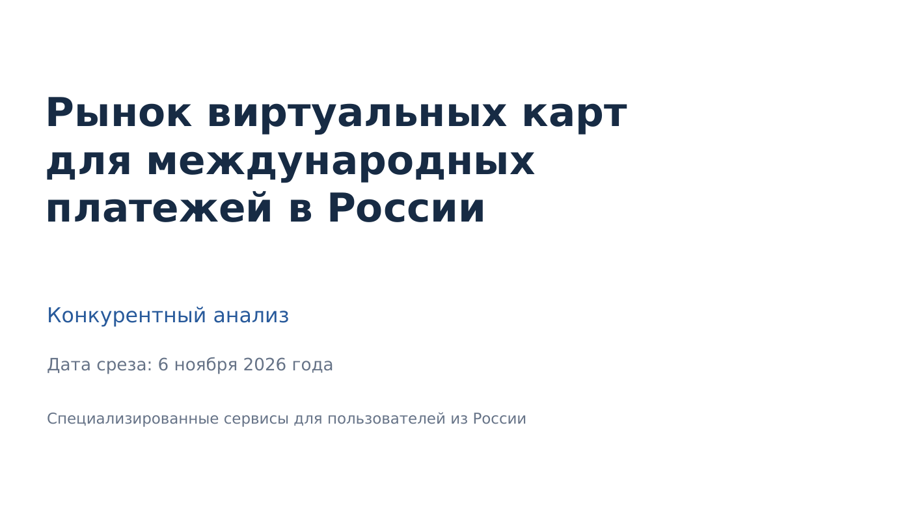

# Рынок виртуальных карт для международных платежей в России

**Конкурентный анализ · Дата среза: 6 ноября 2026 года**

Исследование специализированных сервисов виртуальных карт для пользователей из России: сравнение продуктов и тарифов, каналов привлечения, сценарной стоимости использования и динамики спроса.

## Материалы

| Документ | Что внутри | Ссылка |
|---|---|---|
| **Презентация (PDF)** | 12 слайдов с основными результатами и рекомендациями | [Открыть](03_executive_presentation.pdf) |
| **Аналитический отчёт (PDF)** | 15 страниц: методология, данные, сравнения, выводы и источники | [Читать](01_market_research_report.pdf) |
| **Excel-модель** | Скоринг конкурентов, товарные матрицы, TCO и чувствительность к FX | [Расчёты](02_competitor_analysis_and_tco.xlsx) |
| **Презентация (PPTX)** | Редактируемая версия слайдов | [Скачать](03_executive_presentation.pptx) |
| **Отчёт (DOCX)** | Редактируемая версия исследования | [Скачать](04_editable_research_report.docx) |

## Объект исследования

Специализированные B2C-сервисы виртуальных карт для международных онлайн-платежей, доступные российским пользователям. Банковские виртуальные карты для внутренних платежей и отдельные B2B-решения не входят в основной сравнительный периметр.

**Пять участников сравнительной выборки:** «Плати по всему миру», WantToPay, VESMIR, Kartli и Aifory Pro. Выбор основан на экспертной скоринговой модели; **это не рейтинг по рыночной доле или выручке**.

## Основные результаты

- **Цена выпуска не равна полной стоимости использования.** Важны обслуживание, комиссии за покупки и отказы, а также курс пополнения.
- **Условия зависят от поведения клиента.** Для разовой покупки и регулярных платежей разные тарифы оказываются экономически привлекательными; модель охватывает горизонты **1, 3 и 12 месяцев**.
- **Трафик наблюдаем не полностью.** Сопоставимые публичные оценки Similarweb доступны только для двух доменов; аудитория Telegram и мобильных приложений не оценивается по визитам на сайт.
- **Спрос на решение задачи зарубежной оплаты меняется.** По опубликованным округлённым данным Wordstat, запрос «оплата зарубежных сервисов» вырос на **127,2%** за июнь–август 2026 года относительно того же периода 2025 года. Это показатель поискового интереса, **не денежного роста рынка**.

## Методология и ограничения

Использованы открытые тарифы и условия сервисов, внешние веб-оценки, опубликованные данные поискового спроса и воспроизводимые расчёты в Excel. Исходные ссылки и допущения приведены в [отчёте](01_market_research_report.pdf) и [модели](02_competitor_analysis_and_tco.xlsx).

**Важно:** фактический средний чек клиентов и денежный объём рассматриваемого сегмента не установлены из открытых данных. TCO — сценарная стоимость использования, а не фактический средний чек. Неизвестные валютные спреды не приписываются конкретным сервисам.

---

*Материалы подготовлены по состоянию на 6 ноября 2026 года. Изменения тарифов и доступности сервисов после этой даты не отражены.*
